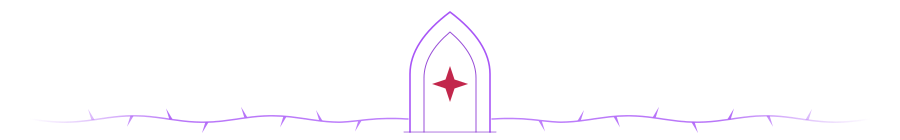

  

<h1 align="center">
  Hey, hi, I'm Adair Hernández
  
</h1>

  <b>AI Engineering student at ESCOM-IPN</b> · Mexico City, Mexico 
  Computer vision · Parallel computing · Evolutionary algorithms

## 👤 About Me

- 🏫 Second-year student at **ESCOM** (Escuela Superior de Cómputo, IPN)
- 📚 Studying **Artificial Intelligence Engineering**
- 🌎 Based in **Mexico City, Mexico**
- 🔬 Interested in underwater image restoration, symbolic regression, high-performance computing and machine learning
- 🎮 Outside of code: music and gaming
- ⚡ Fun fact: I sometimes sleep only 4–6 hours, but I always give 100%

## 🚀 Featured Projects

| Project                                                                                                                                        | Description                                                                                                                                              | Stack        |
| ---------------------------------------------------------------------------------------------------------------------------------------------- | -------------------------------------------------------------------------------------------------------------------------------------------------------- | ------------ |
| [**Fast-Sea-Thru**](https://github.com/ShyAd1/Fast-Sea-Thru)                                                                                   | Underwater image restoration (MiDaS depth estimation, backscatter removal, CUDA illuminant map) plus download tools for the FathomNet CLEF 2026 dataset. | Python, CUDA |
| [**Genetic-Programming-to-Generate-Mathematical-Functions**](https://github.com/ShyAd1/Genetic-Programming-to-Generate-Mathematical-Functions) | Symbolic regression with DEAP: mathematical expressions evolve through genetic operators to approximate a target function.                               | Python, DEAP |
| [**Parallel-Computing**](https://github.com/ShyAd1/Parallel-Computing)                                                                         | Coursework implementations of parallel and distributed computing concepts in C.                                                                          | C            |
| [**Simon-Says-Game**](https://github.com/ShyAd1/Simon-Says-Game)                                                                               | A Simon Says game built around a core data structure.                                                                                                    | C            |
| [**Artificial-Vision**](https://github.com/ShyAd1/Artificial-Vision)                                                                           | Computer vision exercises and experiments.                                                                                                               | MATLAB       |
| [**Theory-of-computation**](https://github.com/ShyAd1/Theory-of-computation)                                                                   | Automata and formal language exercises.                                                                                                                  | Java         |

##  Languages and Tools

**Languages**

**Data Science & AI**

**Databases**

**Tools**

##  GitHub Stats

 

## 📫 Connect with Me

  
  
  

  

